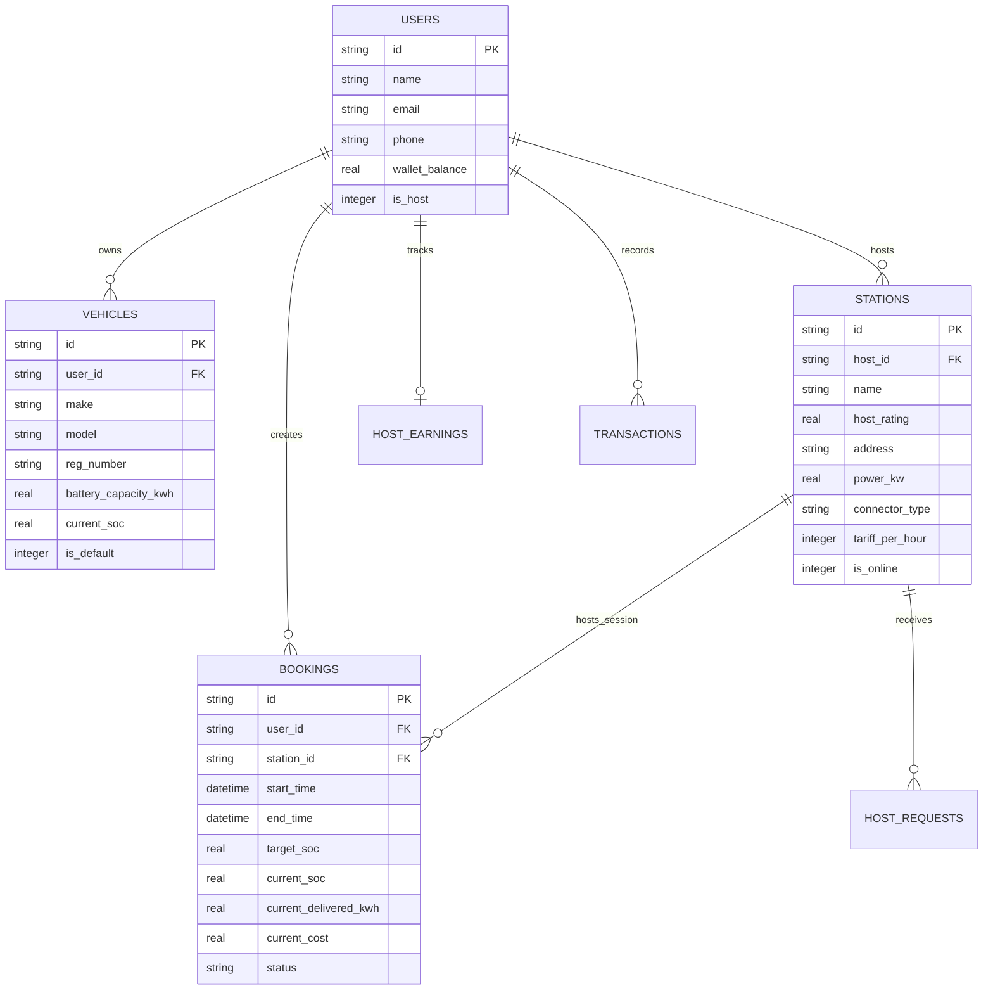

# ⚡ Find My Volt - Community EV Charging Platform

> **Peer-to-Peer Electric Vehicle Charging Network**  
> Built with Flutter, Python REST API, SQLite Relational Database, and deployed live to **AWS Free Tier**.

[](https://flutter.dev)
[](https://python.org)
[](https://sqlite.org)
[](https://aws.amazon.com)
[](file:///test)

---

## 🌟 Live Cloud Deployment

The backend and database are deployed and actively running in **AWS Free Tier** (`ap-south-2` / Hyderabad):

- **Live REST API**: [`http://16.113.152.82/api`](http://16.113.152.82/api)
- **Live Health Check**: [`http://16.113.152.82/api/health`](http://16.113.152.82/api/health)
- **Direct API Port**: [`http://16.113.152.82:5000/api`](http://16.113.152.82:5000/api)
- **EC2 Instance**: `t3.micro` (750 hours/month Free Tier)
- **Persistent Storage**: 30 GB gp3 encrypted EBS volume

---

## 📱 Mobile App Screens (Stitch Design Fidelity)

Find My Volt is built with pixel-perfect fidelity to the original Stitch mobile app design specification:

1. **Nearby Chargers Map (`/`)**: Interactive map with real-time station cards, vehicle filter chips, quick filters, and live search.
2. **Charger Details (`/charger-details`)**: Host credentials, superhost badge, live pricing, amenity badges (Solar, CCTV, Covered Bay), and connector compatibility.
3. **Reserve Slot (`/reserve-slot`)**: Interactive date picker, slot duration selector, dynamic pricing breakdown, and pass-code generation.
4. **Checkout & Payment (`/checkout`)**: Wallet deduction, UPI, NetBanking, instant confirmation, and transaction tracking.
5. **Live Charging Session (`/bookings`)**: Real-time SOC percentage animation, delivered kWh telemetry, live session timer, and session completion.
6. **Host Mode Dashboard (`/host-mode`)**: Revenue tracking (monthly earnings, session count, host rating), incoming driver requests, and bay availability toggle.
7. **Availability Calendar (`/availability-calendar`)**: Host calendar slot scheduler with recurring day/night charging blocks.
8. **List Your Charger Wizard (`/list-charger`)**: Multi-step wizard with location, photos, power rating, tariff rates, and bay amenities.
9. **User Profile & EV Garage (`/profile`)**: Registered EV management, default vehicle switcher, wallet balance top-up, and transaction ledger.
10. **Host Chat (`/chat`)**: Real-time interactive messaging between EV driver and station host.

---

## 🏗️ Architecture

```
find_my_volt/
├── aws/                                # AWS CloudFormation and deployment automation
│   ├── cloudformation.yaml             # Free Tier IaC (VPC, EC2 t3.micro, 30GB EBS, SG)
│   ├── deploy.ps1                      # Automated deployment script for PowerShell
│   ├── deploy.sh                       # Automated deployment script for Bash / CI-CD
│   └── serverless/                     # AWS Lambda 1M free requests/month alternative
├── backend/                            # Clean REST API Backend
│   ├── database/
│   │   ├── schema.sql                  # 8 Relational SQLite tables & indexes
│   │   └── db.py                       # Thread-safe DAO layer & auto-seed engine
│   ├── server.py                       # CORS-enabled REST API server (Python stdlib)
│   ├── test_db.py                      # Database unit test suite
│   ├── Dockerfile                      # Multi-stage production container
│   └── docker-compose.yml              # Container compose with persistent volume
├── lib/                                # Flutter Clean Architecture Frontend
│   ├── models/models.dart              # Domain entities with fromJson/toJson/copyWith
│   ├── services/api_service.dart       # HTTP client connecting to AWS / Local API
│   ├── data/repositories/              # Repository layer single source of truth
│   ├── state/app_state.dart            # Reactive AppState with optimistic UI & auto-sync
│   ├── screens/                        # 10 Stitch-inspired mobile screens
│   ├── theme/app_theme.dart            # Modern Emerald EV Design System
│   └── widgets/                        # Reusable glassmorphic UI components
└── test/                               # Comprehensive automated test suite
    ├── backend_integration_test.dart   # Model & API integration tests (12 tests)
    ├── realtime_state_test.dart        # Real-time state mutation tests
    ├── navigation_test.dart            # Complete end-to-end screen navigation (10 tests)
    └── widget_test.dart                # Component tests
```

---

## 🗄️ Database Schema

The database consists of **8 relational tables** with foreign key cascading and indices:



---

## 🚀 Getting Started

### Prerequisites
- [Flutter SDK](https://docs.flutter.dev/get-started/install) (3.24+)
- [Python](https://python.org) (3.10+)

### 1. Clone the Repository
```bash
git clone https://github.com/24f2005141/Find-my-volt.git
cd Find-my-volt
```

### 2. Install Flutter Dependencies
```bash
flutter pub get
```

### 3. Run the App
- **Connected to Live AWS Cloud Backend**:
  ```bash
  flutter run -d chrome
  ```
- **Connected to Local Backend**:
  ```bash
  # In terminal 1: start local backend
  python backend/server.py

  # In terminal 2: run flutter app pointing to localhost
  flutter run -d chrome --dart-define=API_BASE_URL=http://localhost:5000/api
  ```

---

## 🧪 Testing

Run the full automated test suite (all 23 tests):
```bash
flutter test
```

Run the backend database test suite:
```bash
python backend/test_db.py
```

---

## 📄 License
This project is licensed under the MIT License.
